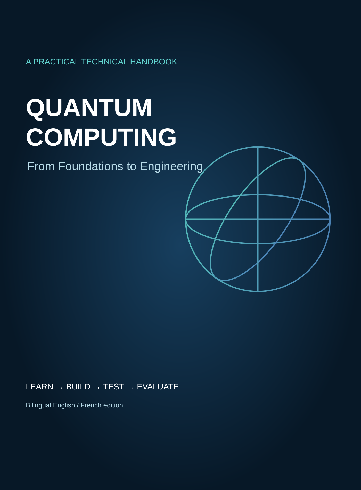

# Quantum Computing: From Foundations to Engineering

A practical, bilingual undergraduate handbook.

**Learn → Build → Test → Evaluate**

- [24-chapter roadmap](book/BOOK_BLUEPRINT.md)
- [Read the manuscript chapters](book/chapters.md)
- [Editorial charter](editorial/EDITORIAL_CHARTER.md)
- [Figure, circuit and table standards](editorial/VISUAL_STANDARDS.md)
- [Practical lab standard](labs/LAB_STANDARD.md)
- [Source repository and notebooks](https://github.com/msellamiTN/quantum-computing-book)

A chapter is not marked complete until its scientific, editorial and practical validation gates have passed.
