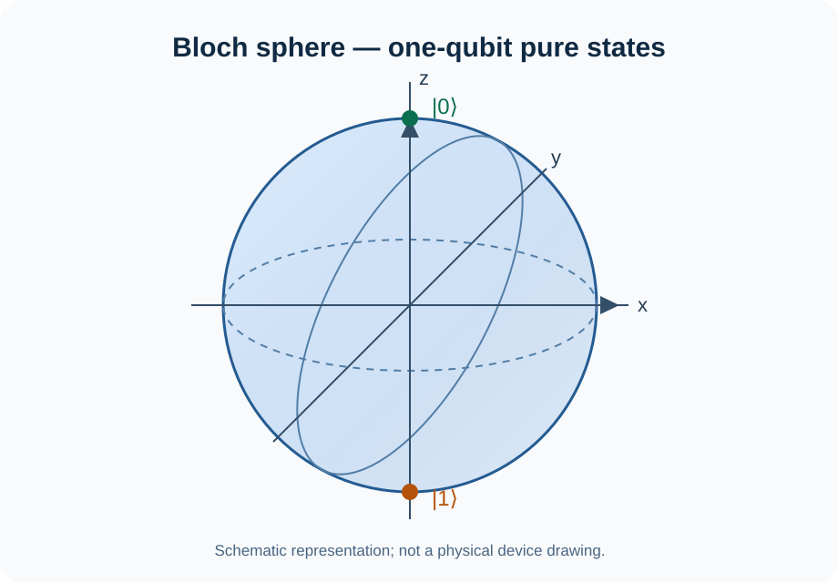
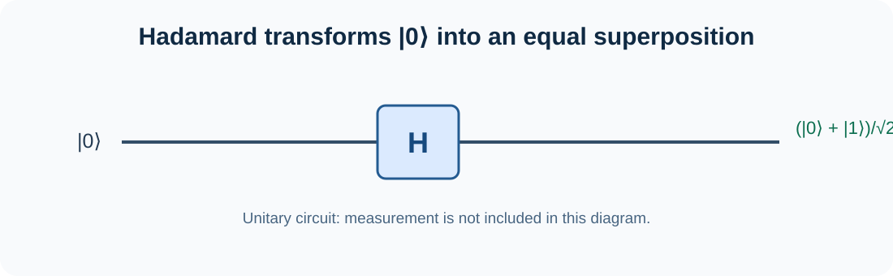

# Chapter 1 — What Is Quantum Computing?

> **Learning path:** Getting Started · **Level:** Undergraduate · **Prerequisites:** basic Python, elementary algebra and probability  
> **Central question:** What changes when information is represented by quantum states rather than classical bits?

## Learning objectives
By the end of this chapter, you should be able to:
1. distinguish a classical bit from a qubit;
2. interpret a normalized one-qubit state;
3. calculate measurement probabilities using the Born rule;
4. explain what the Hadamard gate does to \\(|0\\rangle\\);
5. build and inspect a one-qubit circuit with Qiskit;
6. distinguish exact statevector probabilities from finite-shot results.

## 1.1 Classical information as a starting point
A classical bit takes one of two logical values: 0 or 1. A quantum computer also uses information-bearing physical systems, but the mathematical description of a qubit is different.

A pure one-qubit state in the computational basis is

\\[
|\\psi\\rangle = \\alpha |0\\rangle + \\beta |1\\rangle,
\\tag{1.1}
\\]

where \\(\\alpha,\\beta\\in\\mathbb C\\) are probability amplitudes. A normalized state satisfies

\\[
|\\alpha|^2 + |\\beta|^2 = 1.
\\tag{1.2}
\\]

The amplitudes are generally complex and are not themselves probabilities.

## 1.2 Measurement and the Born rule
When measured in the computational basis, the probability of outcome 0 is \\(|\\alpha|^2\\), and the probability of outcome 1 is \\(|\\beta|^2\\).

**Table 1.1 — Amplitudes and measurement probabilities for a normalized qubit**

| Outcome | Amplitude | Probability |
|---|---|---:|
| 0 | \\(\\alpha\\) | \\(|\\alpha|^2\\) |
| 1 | \\(\\beta\\) | \\(|\\beta|^2\\) |
| Total | — | 1 |

For \\(\\alpha=1/\\sqrt{2}\\) and \\(\\beta=1/\\sqrt{2}\\), each outcome has probability 1/2. One measurement does not reveal both amplitudes; it returns one classical result.



**Figure 1.1 — Bloch-sphere representation.** A pure qubit state is represented by a point on the unit sphere; the poles correspond to computational basis states. This is a conceptual schematic, not a device drawing.

## 1.3 The Hadamard gate
The Hadamard gate is

\\[
H=\\frac{1}{\\sqrt{2}}
\\begin{bmatrix}
1 & 1 \\\\
1 & -1
\\end{bmatrix}.
\\tag{1.3}
\\]

Applying it to \\(|0\\rangle\\) gives

\\[
H|0\\rangle=\\frac{|0\\rangle+|1\\rangle}{\\sqrt{2}}.
\\tag{1.4}
\\]

This is an equal superposition in the computational basis. Measuring in that basis returns 0 or 1 with probability 1/2. Superposition does not mean that a measurement returns both values.



**Figure 1.2 — One-qubit Hadamard circuit.** The input begins in \\(|0\\rangle\\); H transforms the state. Measurement is omitted in this unitary-only circuit.

## 1.4 Practical lab: create and inspect a superposition
See [Lab 01 — First Qubit and Superposition](../../../labs/chapter-01/README.md) for complete setup, notebook, script, tests, expected output and troubleshooting.

```python
from qiskit import QuantumCircuit
from qiskit.quantum_info import Statevector

qc = QuantumCircuit(1)
qc.h(0)
state = Statevector.from_instruction(qc)
print(qc.draw())
print(state)
print(state.probabilities_dict())
```

This computes an exact ideal statevector. It is not a finite-shot experiment and does not execute on a physical QPU.

## 1.5 Common misconceptions
- **“A qubit is simply both 0 and 1.”** A precise description is a normalized state with amplitudes relative to a basis.
- **“Amplitudes are probabilities.”** Probabilities are squared magnitudes of amplitudes.
- **“One measurement reveals the whole state.”** A measurement returns one classical result.
- **“A simulator is a quantum processor.”** A classical simulator computes a model; hardware introduces physical and operational constraints.

## Knowledge check
1. What condition must \\(\\alpha\\) and \\(\\beta\\) satisfy?
2. If \\(\\alpha=0\\) and \\(\\beta=1\\), what is the state?
3. What is the probability of outcome 1 in Equation (1.4)?
4. Why is an exact statevector different from a finite-shot histogram?

## Summary
A qubit is described by probability amplitudes, measurement probabilities follow the Born rule, and Hadamard maps \\(|0\\rangle\\) to an equal superposition. The next chapter develops vectors, complex numbers and probability.

## References
- Nielsen, M. A. and Chuang, I. L., *Quantum Computation and Quantum Information*, Cambridge University Press.
- Qiskit documentation: https://docs.quantum.ibm.com/
