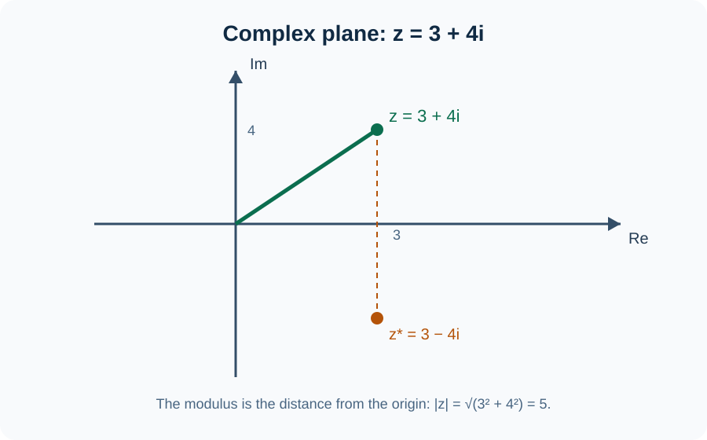

# Chapter 2 — The Mathematics You Need

> **Path:** Getting Started · **Level:** Undergraduate · **Prerequisites:** algebra, functions and basic probability  
> **Guiding question:** Which mathematical tools let us calculate and predict the behavior of quantum circuits?

## Learning objectives

You will learn to:
1. manipulate complex numbers and calculate their modulus;
2. represent quantum states as vectors;
3. calculate inner products and vector norms;
4. understand matrices as linear transformations;
5. recognize unitary matrices and why they preserve normalization;
6. connect amplitudes to probabilities.

## 2.1 Complex numbers

A complex number has the form
\[
z=a+ib,\qquad a,b\in\mathbb R,\quad i^2=-1.
\]
Its complex conjugate is \(z^*=a-ib\), and its modulus is
\[
|z|=\sqrt{zz^*}=\sqrt{a^2+b^2}.
\]
For example, if \(z=3+4i\), then \(z^*=3-4i\) and \(|z|^2=25\). Quantum probabilities are real and non-negative; for a complex amplitude \(z\), the associated squared magnitude is \(|z|^2=zz^*\), not \(z^2\).

**Table 2.1 — Complex-number operations used in quantum mechanics**

| Operation | Definition | Example for \(z=3+4i\) |
|---|---|---|
| Conjugate | \(z^*\) | \(3-4i\) |
| Modulus squared | \(zz^*\) | 25 |
| Real part | \(\Re(z)\) | 3 |
| Imaginary part | \(\Im(z)\) | 4 |

**Figure 2.1 — Complex plane and conjugation.** The conjugate reflects the point across the real axis; the modulus is its distance from the origin.

## 2.2 Vectors and inner products

A state vector for a single qubit is written
\[
|\psi\rangle=\begin{bmatrix}\alpha\\\beta\end{bmatrix}.
\]
The corresponding bra is the conjugate transpose:
\[
\langle\psi|=\begin{bmatrix}\alpha^*&\beta^*\end{bmatrix}.
\]
The inner product is \(\langle\psi|\psi\rangle=|\alpha|^2+|\beta|^2\). A normalized state has norm one:
\[
\langle\psi|\psi\rangle=1.
\tag{2.1}
\]
Two states are orthogonal when their inner product is zero.

## 2.3 Matrices as transformations

A matrix acts on a column vector from the left. For a qubit,
\[
|\psi'\rangle=U|\psi\rangle.
\]
A matrix is unitary if
\[
U^\dagger U=UU^\dagger=I,
\tag{2.2}
\]
where \(U^\dagger\) is the conjugate transpose. Unitary transformations preserve inner products and therefore preserve state normalization:
\[
\langle\psi'|\psi'\rangle
=\langle\psi|U^\dagger U|\psi\rangle
=\langle\psi|\psi\rangle.
\]
This is why ideal closed-system quantum gates are represented by unitary operators.

## 2.4 A worked example: the Pauli-X gate

\[
X=\begin{bmatrix}0&1\\1&0\end{bmatrix},\qquad
X|0\rangle=|1\rangle,\quad X|1\rangle=|0\rangle.
\]
The matrix swaps the computational basis states. It is unitary because \(X^\dagger X=I\).

## 2.5 Global phase

The states \(|\psi\rangle\) and \(e^{i\phi}|\psi\rangle\) produce the same measurement probabilities and represent the same physical pure state when the phase is global. Relative phase between components, however, can affect interference. This distinction becomes important in later chapters.

## 2.6 Practical lab

In [Lab 02 — Complex Numbers, Vectors and Gates](../../../labs/chapter-02/README.md), implement complex amplitudes with NumPy, verify normalization, construct X and H matrices, and compare matrix calculations with Qiskit's statevector output.

## Common mistakes

- Squaring a complex amplitude without taking its modulus.
- Treating a row vector as interchangeable with its conjugate transpose.
- Assuming every matrix is a valid quantum gate; ideal gates must be unitary.
- Confusing global phase with relative phase.

## Knowledge check

1. Compute \(|2-3i|^2\).
2. Normalize \((1,1)^T\).
3. Verify that the Pauli-X matrix is unitary.
4. Explain why a unitary transformation preserves a normalized state's norm.
5. Does changing a global phase change computational-basis probabilities?

## Summary

Complex conjugation, vector norms, inner products and unitary matrices are the basic language of pure-state quantum computing. The next chapter uses this language to describe quantum states and measurements systematically.

## References

- Nielsen and Chuang, *Quantum Computation and Quantum Information*.
- Qiskit documentation: https://docs.quantum.ibm.com/
