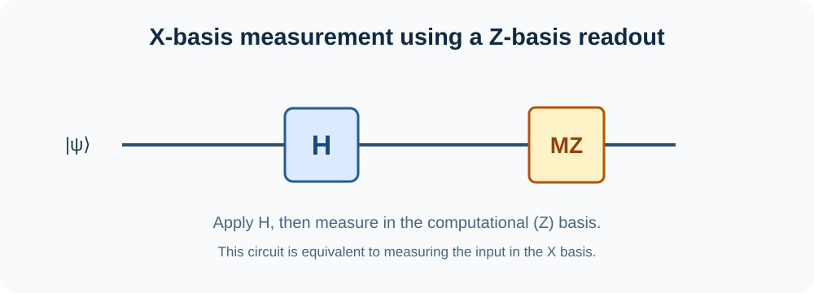

# Chapter 3 — Quantum States and Dirac Notation

> **Path:** Getting Started · **Question:** How do we describe a quantum state independently of a particular circuit?

## Learning objectives
- Read ket and bra notation.
- Express a state in a chosen orthonormal basis.
- Apply the Born rule to a general measurement basis.
- Distinguish a state vector from its coordinate representation.
- Explain normalization, orthogonality and global phase.

## 3.1 Kets, bras and basis states

Dirac notation writes a state as a ket, \(|\psi\rangle\), and its conjugate transpose as a bra, \(\langle\psi|\). The computational basis for one qubit is
\[
|0\rangle=\begin{bmatrix}1\\0\end{bmatrix},\qquad
|1\rangle=\begin{bmatrix}0\\1\end{bmatrix}.
\]
These vectors are orthonormal:
\[
\langle0|0\rangle=\langle1|1\rangle=1,\quad
\langle0|1\rangle=\langle1|0\rangle=0.
\]

## 3.2 Expansion in a basis

Any pure one-qubit state can be expanded in the computational basis:
\[
|\psi\rangle=\alpha|0\rangle+\beta|1\rangle,
\quad |\alpha|^2+|\beta|^2=1.
\]
The coefficients depend on the chosen basis. The state is the abstract physical description; the vector is its coordinate representation in a specified basis.

## 3.3 Measurement as projection

For measurement in the computational basis, the projectors are
\[
P_0=|0\rangle\langle0|,\qquad P_1=|1\rangle\langle1|.
\]
For a normalized state, the probability of outcome \(k\) is
\[
p(k)=\langle\psi|P_k|\psi\rangle.
\tag{3.1}
\]
After observing outcome \(k\), the post-measurement state for this projective measurement is \(P_k|\psi\rangle/\sqrt{p(k)}\), provided \(p(k)>0\).

## 3.4 Measurement basis matters

The same state can have different outcome distributions in different bases. Define
\[
|+\rangle=\frac{|0\rangle+|1\rangle}{\sqrt2},\quad
|-\rangle=\frac{|0\rangle-|1\rangle}{\sqrt2}.
\]
The state \(|+\rangle\) is certain to produce + when measured in the X basis, but gives 0 and 1 with equal probability in the computational (Z) basis. A Hadamard before a computational-basis measurement implements an X-basis measurement.

**Table 3.1 — Selected one-qubit states and computational-basis probabilities**

| State | Amplitudes (0, 1) | P(0) | P(1) |
|---|---|---:|---:|
| \(|0\rangle\) | (1, 0) | 1 | 0 |
| \(|1\rangle\) | (0, 1) | 0 | 1 |
| \(|+\rangle\) | \((1/\sqrt2,1/\sqrt2)\) | 1/2 | 1/2 |
| \(|-\rangle\) | \((1/\sqrt2,-1/\sqrt2)\) | 1/2 | 1/2 |

**Figure 3.1 — Measuring in the X basis.** Applying H before a computational-basis readout implements an X-basis measurement.

## 3.5 Global and relative phase

Multiplying an entire ket by a phase \(e^{i\phi}\) leaves all measurement probabilities unchanged. Changing only one component generally changes relative phase and can affect later interference. For example, H maps |+⟩ to |0⟩ and |−⟩ to |1⟩; the minus sign is therefore operationally meaningful relative to the other component.

## 3.6 Practical lab

[Lab 03 — State preparation and measurement bases](../../../labs/chapter-03/README.md) constructs |0⟩, |1⟩, |+⟩ and |−⟩, calculates their statevectors and demonstrates Z- versus X-basis measurement using circuits.

## Knowledge check
1. What is the difference between a ket and its bra?
2. Why must a normalized state have squared amplitudes summing to one?
3. What is the probability of outcome 0 for |+⟩ in the Z basis?
4. How can a circuit measure in the X basis using a standard computational-basis measurement?
5. Why is relative phase observable through interference while global phase is not?

## Summary
Dirac notation separates a state from its coordinates, projectors express ideal measurements, and measurement probabilities depend on the chosen basis. Chapter 4 extends the description to multiple qubits using tensor products.

## References
- Nielsen and Chuang, *Quantum Computation and Quantum Information*.
