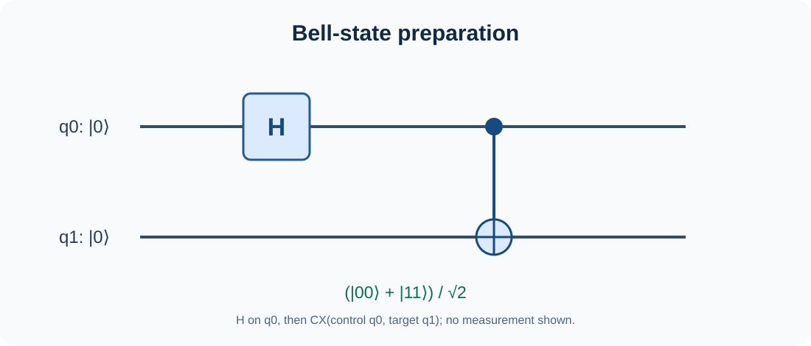

# Chapter 4 — Multiple Qubits and Tensor Products

> **Path:** Getting Started · **Guiding question:** How does the state space grow when we combine qubits?

## Learning objectives
- Construct a two-qubit state using a tensor product.
- Identify the computational basis for two qubits.
- Explain why an n-qubit pure state needs 2^n complex amplitudes.
- Distinguish product states from entangled states.
- Read Qiskit qubit indexing and statevector ordering correctly.

## 4.1 Combining two state spaces

If qubit A is in \(|\psi\rangle=\alpha|0\rangle+\beta|1\rangle\) and qubit B is in \(|\phi\rangle=\gamma|0\rangle+\delta|1\rangle\), their joint product state is
\[
|\psi\rangle\otimes|\phi\rangle
=\alpha\gamma|00\rangle+\alpha\delta|01\rangle
+\beta\gamma|10\rangle+\beta\delta|11\rangle.
\tag{4.1}
\]
The tensor product combines amplitudes and creates a four-dimensional state space.

## 4.2 Two-qubit computational basis

The standard basis is \(|00\rangle, |01\rangle, |10\rangle, |11\rangle\). A general pure state is
\[
|\Psi\rangle=c_{00}|00\rangle+c_{01}|01\rangle
+c_{10}|10\rangle+c_{11}|11\rangle,
\]
with
\[
|c_{00}|^2+|c_{01}|^2+|c_{10}|^2+|c_{11}|^2=1.
\tag{4.2}
\]

**Table 4.1 — State-space size**

| Number of qubits n | Basis states | Complex amplitudes |
|---:|---:|---:|
| 1 | 2 | 2 |
| 2 | 4 | 4 |
| 3 | 8 | 8 |
| 10 | 1,024 | 1,024 |
| 20 | 1,048,576 | 1,048,576 |

This exponential statevector size is a classical simulation cost, not by itself proof of quantum computational advantage.

## 4.3 Product states and entanglement

A pure multi-qubit state is a product state if it can be factored into one-qubit states. For example,
\[
|+\rangle\otimes|0\rangle
=\frac{|00\rangle+|10\rangle}{\sqrt2}
\]
is separable. By contrast,
\[
|\Phi^+\rangle=\frac{|00\rangle+|11\rangle}{\sqrt2}
\tag{4.3}
\]
cannot be factored into a product of two one-qubit pure states; it is entangled. Measuring either qubit in the computational basis gives a random result, but the two results are perfectly correlated.

## 4.4 Building a Bell state

Starting from |00⟩, apply H to the first qubit and then a controlled-NOT with that qubit as control and the other as target:
\[
|00\rangle\xrightarrow{H\otimes I}
\frac{|00\rangle+|10\rangle}{\sqrt2}
\xrightarrow{\mathrm{CNOT}}
\frac{|00\rangle+|11\rangle}{\sqrt2}.
\]
The exact wire/index interpretation depends on the library convention; in Qiskit, qubit 0 is the least-significant bit in the computational-basis index. For a two-qubit statevector, displayed bitstrings are conventionally ordered q1 q0. State the convention whenever interpreting bitstrings.

**Figure 4.1 — Bell-state preparation.** H is applied to q0, followed by CX with control q0 and target q1. The ideal output is \((|00\rangle+|11\rangle)/\sqrt2\).

## 4.5 Practical lab

[Lab 04 — Tensor products and Bell-state preparation](../../../labs/chapter-04/README.md) constructs separable and entangled states, inspects statevectors, verifies normalization and checks computational-basis probabilities.

## Common mistakes
- Multiplying amplitudes by ordinary scalar arithmetic instead of using tensor products for joint systems.
- Assuming every two-qubit superposition is entangled.
- Forgetting the exponential growth of the statevector dimension.
- Reading bitstrings without checking the framework's qubit and classical-bit ordering.

## Knowledge check
1. How many amplitudes describe a pure state of four qubits?
2. Expand \(|+\rangle\otimes|1\rangle\).
3. Why is the Bell state not a product state?
4. What measurement correlations are expected from |Φ+⟩ in the computational basis?
5. Why must Qiskit bitstring ordering be documented?

## Summary
Tensor products combine subsystem state spaces. Some joint states factor into independent subsystem states; entangled states do not. The next part of the book uses these foundations to design and analyze quantum circuits.

## References
- Nielsen and Chuang, *Quantum Computation and Quantum Information*.
