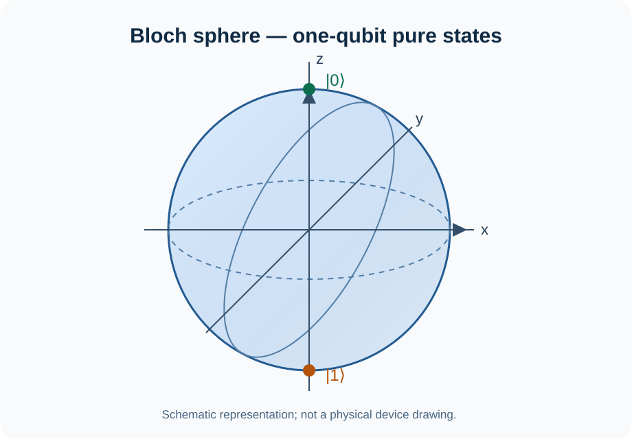
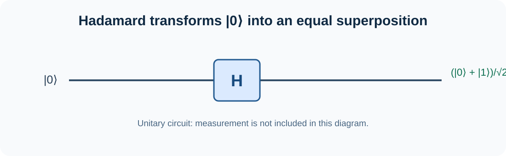

# Chapitre 1 — Qu’est-ce que l’informatique quantique ?

> **Parcours :** Premiers pas · **Niveau :** Licence · **Prérequis :** Python élémentaire, algèbre et probabilités de base  
> **Question centrale :** Qu’est-ce qui change lorsque l’information est représentée par des états quantiques plutôt que par des bits classiques ?

## Objectifs pédagogiques
À la fin de ce chapitre, vous saurez :
1. distinguer un bit classique d'un qubit ;
2. interpréter un état normalisé à un qubit ;
3. calculer les probabilités de mesure avec la règle de Born ;
4. expliquer l'action de Hadamard sur \\(|0\\rangle\\) ;
5. construire et inspecter un circuit à un qubit avec Qiskit ;
6. distinguer les probabilités exactes du vecteur d'état des résultats issus d'un nombre fini de mesures.

## 1.1 L'information classique comme point de départ
Un bit classique prend l'une de deux valeurs logiques : 0 ou 1. Un ordinateur quantique utilise aussi des systèmes physiques porteurs d'information, mais la description mathématique d'un qubit est différente.

Un état pur à un qubit dans la base computationnelle s'écrit

\\[
|\\psi\\rangle = \\alpha |0\\rangle + \\beta |1\\rangle,
\\tag{1.1}
\\]

où \\(\\alpha,\\beta\\in\\mathbb C\\) sont des amplitudes de probabilité. Un état normalisé vérifie

\\[
|\\alpha|^2 + |\\beta|^2 = 1.
\\tag{1.2}
\\]

Les amplitudes sont en général complexes et ne sont pas directement des probabilités.

## 1.2 Mesure et règle de Born
Lors d'une mesure dans la base computationnelle, la probabilité d'obtenir 0 vaut \\(|\\alpha|^2\\), et celle d'obtenir 1 vaut \\(|\\beta|^2\\).

**Tableau 1.1 — Amplitudes et probabilités de mesure d'un qubit normalisé**

| Résultat | Amplitude | Probabilité |
|---|---|---:|
| 0 | \\(\\alpha\\) | \\(|\\alpha|^2\\) |
| 1 | \\(\\beta\\) | \\(|\\beta|^2\\) |
| Total | — | 1 |

Pour \\(\\alpha=1/\\sqrt{2}\\) et \\(\\beta=1/\\sqrt{2}\\), chaque résultat a une probabilité de 1/2. Une mesure isolée ne révèle pas les deux amplitudes : elle renvoie un résultat classique.



**Figure 1.1 — Représentation sur la sphère de Bloch.** Un état pur d'un qubit correspond à un point de la sphère unité ; les pôles correspondent aux états de la base computationnelle. Ce schéma est conceptuel et ne représente pas un dispositif.

## 1.3 La porte de Hadamard
La porte de Hadamard est

\\[
H=\\frac{1}{\\sqrt{2}}
\\begin{bmatrix}
1 & 1 \\\\
1 & -1
\\end{bmatrix}.
\\tag{1.3}
\\]

Son application à \\(|0\\rangle\\) donne

\\[
H|0\\rangle=\\frac{|0\\rangle+|1\\rangle}{\\sqrt{2}}.
\\tag{1.4}
\\]

Il s'agit d'une superposition équiprobable dans la base computationnelle. Une mesure dans cette base renvoie 0 ou 1 avec une probabilité de 1/2. La superposition ne signifie pas qu'une mesure renvoie simultanément les deux valeurs.



**Figure 1.2 — Circuit de Hadamard à un qubit.** L'entrée est dans l'état \\(|0\\rangle\\) ; H transforme l'état. La mesure est absente de ce circuit unitaire.

## 1.4 Laboratoire : créer et inspecter une superposition
Consultez [Lab 01 — Premier qubit et superposition](../../../labs/chapter-01/README.md) pour les instructions d'installation, le notebook, le script, les tests, les résultats attendus et le dépannage.

```python
from qiskit import QuantumCircuit
from qiskit.quantum_info import Statevector

qc = QuantumCircuit(1)
qc.h(0)
state = Statevector.from_instruction(qc)
print(qc.draw())
print(state)
print(state.probabilities_dict())
```

Ce programme calcule un vecteur d'état idéal exact. Il ne réalise ni une expérience à nombre fini de mesures, ni une exécution sur un processeur quantique physique.

## 1.5 Idées fausses fréquentes
- **« Un qubit vaut simplement 0 et 1 à la fois. »** La description précise est un état normalisé avec des amplitudes relatives à une base.
- **« Les amplitudes sont des probabilités. »** Les probabilités sont les carrés des modules des amplitudes.
- **« Une mesure révèle tout l'état. »** Une mesure renvoie un résultat classique.
- **« Un simulateur est un processeur quantique. »** Un simulateur classique calcule un modèle ; le matériel ajoute des contraintes physiques et opérationnelles.

## Vérification des connaissances
1. Quelle condition \\(\\alpha\\) et \\(\\beta\\) doivent-elles satisfaire ?
2. Si \\(\\alpha=0\\) et \\(\\beta=1\\), quel est l'état ?
3. Quelle est la probabilité d'obtenir 1 dans l'équation (1.4) ?
4. Pourquoi un vecteur d'état exact diffère-t-il d'un histogramme à nombre fini de mesures ?

## Synthèse
Un qubit est décrit par des amplitudes de probabilité, les probabilités de mesure suivent la règle de Born, et Hadamard transforme \\(|0\\rangle\\) en une superposition équiprobable. Le chapitre suivant présente les vecteurs, les nombres complexes et les probabilités.

## Références
- Nielsen, M. A. et Chuang, I. L., *Quantum Computation and Quantum Information*, Cambridge University Press.
- Documentation Qiskit : https://docs.quantum.ibm.com/
