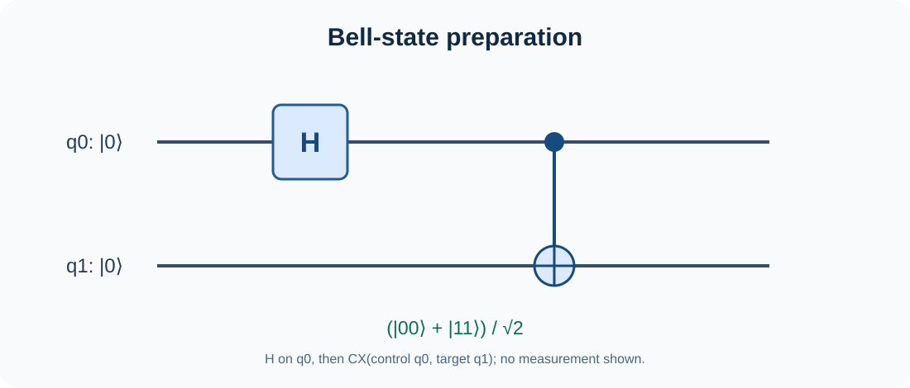

# Chapitre 4 — Plusieurs qubits et produits tensoriels

> **Parcours :** Premiers pas · **Question directrice :** Comment l'espace des états évolue-t-il lorsque l'on combine plusieurs qubits ?

## Objectifs pédagogiques
- Construire un état à deux qubits par produit tensoriel.
- Identifier la base computationnelle à deux qubits.
- Expliquer pourquoi un état pur de n qubits nécessite 2^n amplitudes complexes.
- Distinguer états produits et états intriqués.
- Lire correctement les indices des qubits et l'ordre des vecteurs d'état dans Qiskit.

## 4.1 Combiner deux espaces d'états

Si le qubit A est dans l'état \(|\psi\rangle=\alpha|0\rangle+\beta|1\rangle\) et le qubit B dans \(|\phi\rangle=\gamma|0\rangle+\delta|1\rangle\), leur état produit conjoint est
\[
|\psi\rangle\otimes|\phi\rangle
=\alpha\gamma|00\rangle+\alpha\delta|01\rangle
+\beta\gamma|10\rangle+\beta\delta|11\rangle.
\tag{4.1}
\]
Le produit tensoriel combine les amplitudes et crée un espace d'états de dimension quatre.

## 4.2 Base computationnelle à deux qubits

La base standard est \(|00\rangle, |01\rangle, |10\rangle, |11\rangle\). Un état pur général s'écrit
\[
|\Psi\rangle=c_{00}|00\rangle+c_{01}|01\rangle
+c_{10}|10\rangle+c_{11}|11\rangle,
\]
avec
\[
|c_{00}|^2+|c_{01}|^2+|c_{10}|^2+|c_{11}|^2=1.
\tag{4.2}
\]

**Tableau 4.1 — Dimension de l'espace d'états**

| Nombre de qubits n | États de base | Amplitudes complexes |
|---:|---:|---:|
| 1 | 2 | 2 |
| 2 | 4 | 4 |
| 3 | 8 | 8 |
| 10 | 1 024 | 1 024 |
| 20 | 1 048 576 | 1 048 576 |

Cette taille exponentielle du vecteur d'état représente un coût de simulation classique ; elle ne prouve pas, à elle seule, un avantage du calcul quantique.

## 4.3 États produits et intrication

Un état pur multipartite est un état produit s'il peut être factorisé en états purs à un qubit. Par exemple,
\[
|+\rangle\otimes|0\rangle
=\frac{|00\rangle+|10\rangle}{\sqrt2}
\]
est séparable. En revanche,
\[
|\Phi^+\rangle=\frac{|00\rangle+|11\rangle}{\sqrt2}
\tag{4.3}
\]
ne peut pas être factorisé en produit de deux états purs à un qubit : il est intriqué. Une mesure de chaque qubit dans la base computationnelle donne un résultat aléatoire, mais les deux résultats sont parfaitement corrélés.

## 4.4 Construire un état de Bell

En partant de |00⟩, appliquons H au premier qubit, puis une porte CNOT contrôlée par ce qubit et ciblant l'autre :
\[
|00\rangle\xrightarrow{H\otimes I}
\frac{|00\rangle+|10\rangle}{\sqrt2}
\xrightarrow{\mathrm{CNOT}}
\frac{|00\rangle+|11\rangle}{\sqrt2}.
\]
L'interprétation exacte des fils et des indices dépend de la convention de la bibliothèque. Dans Qiskit, le qubit 0 est le bit de poids faible de l'indice computationnel. Pour un vecteur d'état à deux qubits, les chaînes binaires affichées suivent conventionnellement l'ordre q1 q0. Il faut préciser cette convention lorsqu'on interprète les résultats.

**Figure 4.1 — Préparation d'un état de Bell.** H est appliquée à q0, puis CX avec q0 comme contrôle et q1 comme cible. L'état idéal obtenu est \((|00\rangle+|11\rangle)/\sqrt2\).

## 4.5 Laboratoire pratique

[Lab 04 — Produits tensoriels et préparation d'un état de Bell](../../../labs/chapter-04/README.md) construit des états séparables et intriqués, inspecte les vecteurs d'état, vérifie la normalisation et calcule les probabilités dans la base computationnelle.

## Erreurs fréquentes
- Combiner les amplitudes par simple multiplication scalaire au lieu d'utiliser un produit tensoriel.
- Supposer que toute superposition à deux qubits est intriquée.
- Oublier la croissance exponentielle de la dimension du vecteur d'état.
- Lire une chaîne binaire sans vérifier l'ordre des qubits et des bits classiques de la bibliothèque.

## Vérification des connaissances
1. Combien d'amplitudes décrivent un état pur de quatre qubits ?
2. Développez \(|+\rangle\otimes|1\rangle\).
3. Pourquoi l'état de Bell n'est-il pas un état produit ?
4. Quelles corrélations de mesure attend-on de |Φ+⟩ dans la base computationnelle ?
5. Pourquoi faut-il documenter l'ordre des chaînes binaires Qiskit ?

## Synthèse
Les produits tensoriels combinent les espaces d'états des sous-systèmes. Certains états conjoints se factorisent en états indépendants ; les états intriqués ne le peuvent pas. La partie suivante du livre utilise ces fondements pour concevoir et analyser des circuits quantiques.

## Références
- Nielsen et Chuang, *Quantum Computation and Quantum Information*.
